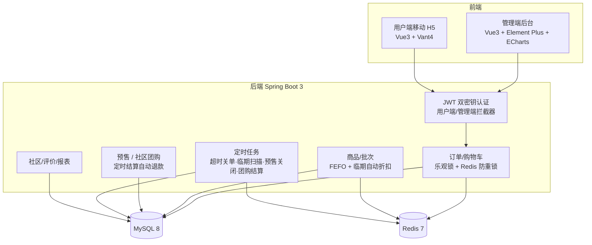

# 社区便民生鲜配送平台

面向社区生鲜"最后一公里"场景的电商系统。前后端分离架构，包含**管理端 PC 后台**与**用户端移动 H5** 两套独立前端、一套 Spring Boot 后端，覆盖从商品上架、批次入库到下单履约、售后评价的完整业务闭环。

针对生鲜"保质期短、按重量计价、损耗高"的行业特性，衍生出**社区自提、预售采摘、临期特价、社区团购、产地溯源**等差异化玩法，并重点解决了**高并发下单防超卖**与**生鲜批次损耗控制**两大核心难题。

## 技术架构



## 技术栈

| 层 | 技术 |
|---|---|
| 后端 | Java 17 · Spring Boot 3.2 · MyBatis-Plus · MySQL 8 · Redis 7（Lettuce）· Knife4j |
| 安全 | JWT 双密钥体系（用户端/管理端独立密钥与有效期）· BCrypt 密码加密 · ThreadLocal 上下文 |
| 管理端 | Vue3 · Element Plus · ECharts（数据工作台多维度报表） |
| 用户端 | Vue3 · Vant4 移动 H5 · Pinia（多端 H5 适配移动端 UI 规范） |
| 工程化 | Maven · Vite · 单元测试（JUnit5 + Mockito）· Docker Compose 全链路部署 |

## 核心亮点

| 难点 | 解决方案 |
|---|---|
| **高并发下单防超卖** | 数据库层乐观锁（`UPDATE ... SET stock=stock-? WHERE stock>=?`，按受影响行数判断）+ Redis `SETNX` 10 秒防重锁拦截重复提交，双重保障 |
| **生鲜损耗控制** | 批次入库时由生产日期+保质期自动计算到期日；下单按 **FEFO（先到期先出）** 顺序扣减批次库存；每日定时扫描，临期批次自动 7 折、过期批次作废并计入损耗报表 |
| **双履约链路** | 配送到家（地址三要素校验）与社区自提（自提点+时间段预约，乐观占用名额，6 位自提码核销）一套订单模型统一流转 |
| **团购状态机** | 发起→满员成团（支付时原子判断）→定时结算：未满员自动流团、批量退款并逐一通知；参团唯一约束兜底防重复 |
| **缓存一致性** | 商品列表/详情 Cache Aside 模式；库存、临期列表在写入路径主动失效，避免脏读 |
| **双端认证隔离** | 用户端 7 天 / 管理端 1 天独立 JWT 密钥，拦截器 + ThreadLocal 传递登录态，防止越权 |

> 每处亮点的核心逻辑均有单元测试覆盖（21 个用例，`mvn test` 全绿），详见 `fresh-server/src/test`。

## 项目结构

```
community-fresh-platform/
├── fresh-server/          # 后端（Spring Boot 3，模块化：user/product/order/presale/groupbuy/...）
├── fresh-admin/           # 管理端 PC 后台（Vue3 + Element Plus + ECharts）
├── fresh-user/            # 用户端移动 H5（Vue3 + Vant4）
├── sql/                   # 20 张表 DDL + 演示数据（商品/批次/预售/团购/订单）
├── upload/                # 商品演示图片
├── docs/                  # 需求 / 业务流程 / 数据库 / 接口 / 运行指南
├── docker-compose.yml     # 全链路一键部署（MySQL + Redis + 三端应用）
└── start_fresh_front.bat  # 本地一键启动两套前端
```

## 快速开始

### 方式一：Docker 一键部署（推荐）

```bash
docker compose up -d --build
```

| 入口 | 地址 | 演示账号 |
|---|---|---|
| 管理端后台 | http://localhost:5173 | admin / 123456 |
| 用户端 H5 | http://localhost:5174 | user1 / 123456（团长：leader1 / 123456） |
| 接口文档 | http://localhost:8080/doc.html | - |

首次启动自动执行建库建表与演示数据脚本；商品图片与数据库数据持久化在 Docker 卷中。

### 方式二：本地开发

**依赖**：JDK 17+ / Node 20+ / MySQL 8 / Redis（也可仅用 `docker compose up -d mysql redis` 起中间件）

```bash
# 1. 初始化数据库
mysql -uroot -p123456 < sql/community_fresh.sql
mysql -uroot -p123456 community_fresh < sql/demo-data.sql
mysql -uroot -p123456 community_fresh < sql/demo-data2.sql

# 2. 启动后端（IDEA 运行 com.fresh.FreshApplication，端口 8080）
#    数据库/Redis 连接在 fresh-server/src/main/resources/application.yml 中修改

# 3. 启动前端（或双击 start_fresh_front.bat）
cd fresh-admin && npm install && npm run dev   # http://localhost:5173
cd fresh-user  && npm install && npm run dev   # http://localhost:5174
```

## 测试

```bash
cd fresh-server && mvn test
```

覆盖核心业务逻辑：团购成团/流团退款结算、临期批次扫描与自动折扣、下单防重锁、自提码核销权限校验、超时关单、批次入库到期日计算等，共 21 个用例。

## 文档

- [01-需求文档](docs/01-需求文档.md)
- [02-业务流程](docs/02-业务流程.md)
- [03-数据库设计](docs/03-数据库设计.md)
- [04-后端模块划分与接口文档](docs/04-后端模块划分与接口文档.md)
- [05-运行指南](docs/05-运行指南.md)

## Roadmap

- [ ] JMeter 压测报告：下单接口 QPS 与防超卖数据沉淀
- [ ] 超时关单由定时轮询演进为 RabbitMQ 延迟消息（削峰 + 精确到期）
- [ ] Redis 防重锁演进为 Redisson 分布式锁（可重入 + 看门狗续期）
- [ ] 管理端 WebSocket 推送新订单/催单提醒
- [ ] CI：GitHub Actions 自动构建与测试