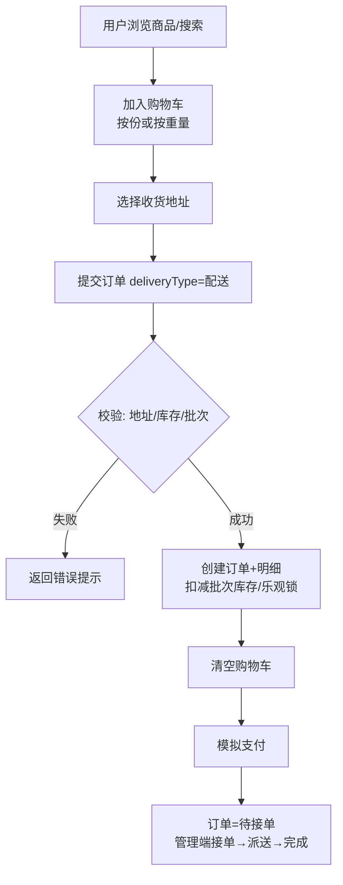
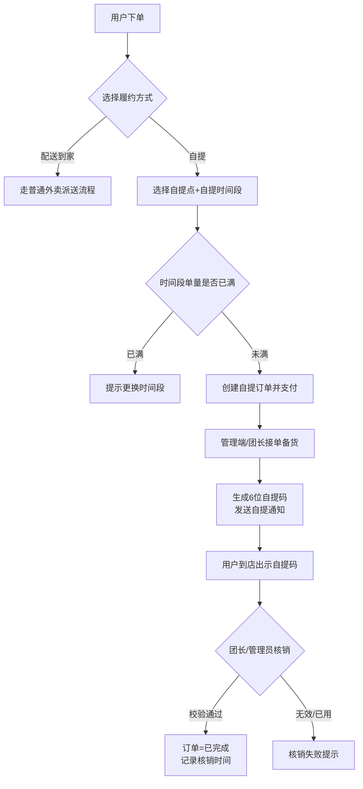
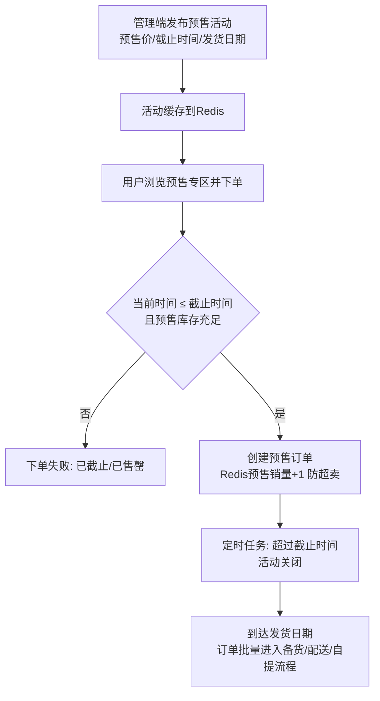
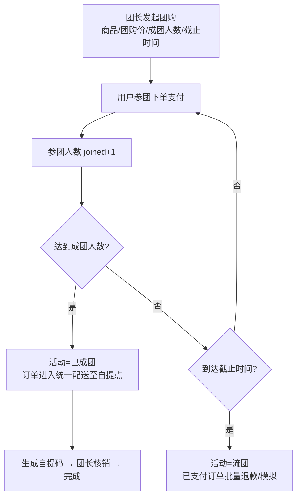
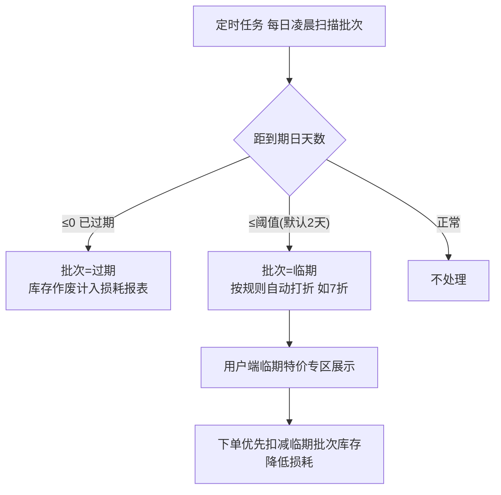
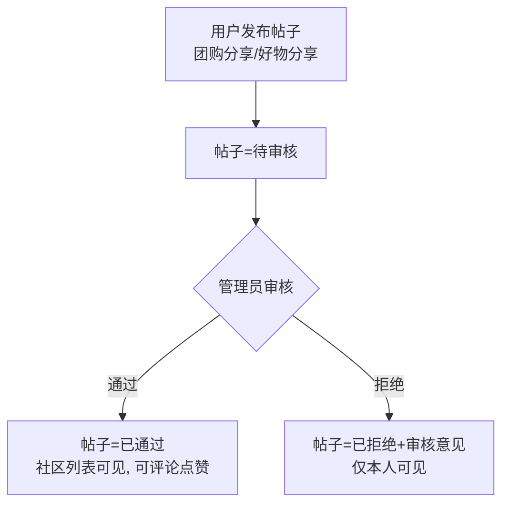

# 社区便民生鲜配送平台 — 业务流程梳理

> 订单主状态机（支持配送到家与社区自提双履约）：
> `1 待付款 → 2 待接单 → 3 备货中/待配送 → 4 配送中/待自提 → 5 已完成`，支干线 `6 已取消`。
> 自提单：3 备货完成 → 4 待自提（生成自提码）→ 核销 → 5 已完成。

---

## 1. 普通下单流程（配送到家）

## 2. 自提流程（社区自提点）

## 3. 预售采摘流程

## 4. 社区团购流程

## 5. 临期特价 / 损耗处理流程

## 6. 社区帖子审核流程

## 7. 角色与权限矩阵

| 功能 | 普通用户 | 团长 | 管理员 |
|---|:-:|:-:|:-:|
| 浏览/购物车/下单/支付/评价 | ✅ | ✅ | – |
| 发帖/评论/点赞 | ✅ | ✅ | – |
| 参团 | ✅ | ✅ | – |
| 发起团购 / 团购后台 | – | ✅ | ✅ |
| 自提码核销 | – | ✅（本自提点） | ✅ |
| 商品/分类/订单/员工/自提点/预售/报表 | – | – | ✅ |
| 帖子审核 | – | – | ✅ |
