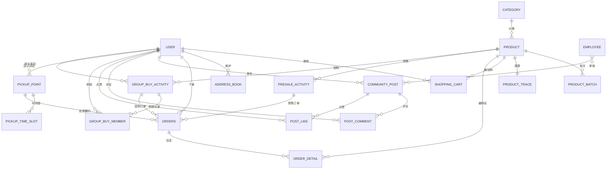

# 社区便民生鲜配送平台 — 数据库设计

> 建表 SQL 见 [sql/community_fresh.sql](../sql/community_fresh.sql)，字符集 utf8mb4，引擎 InnoDB。

## 1. E-R 图

## 2. 表清单

### 2.1 基础表

| 表 | 说明 |
|---|---|---|
| `user` | C 端用户 | 增加账号密码登录字段、`role`（USER/LEADER） |
| `employee` | 管理端员工 | 保持原结构 |
| `category` | 商品分类 | 保持原结构 |
| `product` | 生鲜商品（原 dish） | 新增保鲜类型、保质期、计价方式、库存、预警库存、产地、溯源码等 |
| `shopping_cart` | 购物车 | 新增 `weight`（称重重量）、`batch_id` |
| `address_book` | 地址簿 | 保持原结构 |
| `orders` | 订单 | 新增履约方式、订单类型、自提点、时间段、自提码、预售/团购关联 |
| `order_detail` | 订单明细 | 新增 `batch_id`、`weight` |
| `evaluation` | 商品评价 | 订单完成后对商品打分评价 |
| `notice` | 消息通知 | 新增（自提/成团通知模拟） |

### 2.2 生鲜特色新增表

| 表 | 说明 |
|---|---|
| `product_batch` | 商品批次：生产/到期日期、批次库存、折扣、状态（正常/临期/过期） |
| `product_trace` | 溯源信息：产地、种植户、采摘日期、检测报告、运输信息 |
| `pickup_point` | 社区自提点：地址、经纬度、绑定团长、营业时间 |
| `pickup_time_slot` | 自提时间段：起止时间、单量上限 |
| `presale_activity` | 预售活动：预售价、限购库存、截止时间、发货日期、销量 |
| `group_buy_activity` | 团购活动：团购价、成团人数、已参团数、起止时间、状态 |
| `group_buy_member` | 参团记录：活动、用户、订单、状态 |
| `community_post` | 社区帖子：类型、图文、点赞/评论数、审核状态 |
| `post_comment` | 帖子评论（支持楼中楼 parent_id） |
| `post_like` | 点赞记录（post_id+user_id 唯一） |

## 3. 关键字段设计

### 3.1 product（生鲜商品）
- `fresh_type`：0 常温 / 1 冷藏 / 2 冷冻
- `price_type`：1 按份 / 2 按重量；`unit`：份 / 斤 / kg
- `shelf_life_days`：保质期天数（入库生成批次时计算到期日）
- `stock` / `warn_stock`：库存与预警库存，`stock ≤ warn_stock` 进入预警列表
- `origin_place` + `trace_code`：产地与溯源码（关联 `product_trace`）
- `is_presale`：是否预售商品

### 3.2 product_batch（批次，支撑保质期与临期）
- `status`：1 正常 / 2 临期 / 3 过期
- `discount`：临期自动折扣（如 0.70 表示 7 折）
- 定时任务每日重算状态；下单优先扣减状态最小（临期优先）的批次

### 3.3 orders（订单扩展）
- `delivery_type`：1 配送到家 / 2 自提
- `order_type`：1 普通 / 2 预售 / 3 团购
- `pickup_point_id`、`time_slot_id`、`pickup_code`（自提码）、`pickup_time`（核销时间）
- `presale_id`、`group_activity_id`：业务来源关联
- `status`：1 待付款 2 待接单 3 备货中/待配送 4 配送中/待自提 5 已完成 6 已取消

### 3.4 group_buy_activity / group_buy_member
- 活动：`min_num` 成团人数、`joined_num` 已参团、`status` 0 未开始 1 进行中 2 已成团 3 已完成 4 已流团
- 参团记录唯一约束 `(activity_id, user_id)` 防重复参团

## 4. Redis 缓存设计

| Key 模式 | 内容 | 过期策略 |
|---|---|---|
| `fresh:category:list` | 分类列表 | 变更时删除 |
| `fresh:product:list:{categoryId}` | 首页/分类商品列表 | 变更时删除 |
| `fresh:product:detail:{id}` | 商品详情 | 30 min + 变更删除 |
| `fresh:product:stock:{productId}` | 商品库存（下单预扣校验） | 与 DB 双写 |
| `fresh:presale:{id}` | 预售活动详情+销量 | 活动结束删除 |
| `fresh:near-expiry:list` | 临期特价列表 | 定时任务刷新 |
| `fresh:groupbuy:{id}` | 团购活动详情+参团数 | 活动结束删除 |
| `fresh:order:submit:{userId}` | 下单防重锁 | 10 s |
